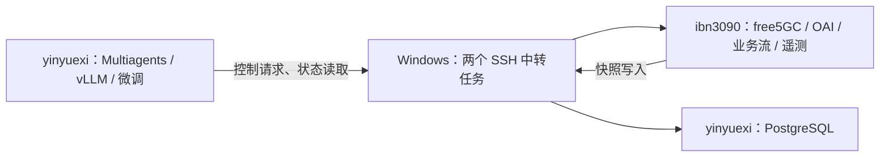

# ibn3090 仿真主机与 Windows 中转

> 2026-10-28：当前源码与仿真入口已恢复到 `/home/xzy/MergedSystem/TestBed`，使用本机数据库和接口。部署命令、固定镜像及真实验收见 [恢复部署记录](../../../docs/recovery-20261028.md)。下文为历史记录，其中旧目录、中转命令和历史运行状态不作为当前操作入口。

> 2026-10-09 更新：Qwen3-8B、vLLM、Multiagents 和 PostgreSQL 已迁到 ibn3090 的 `/home/xzy` 下，运行不再依赖 Windows 中转。当前入口见相邻 Multiagents 仓库的 `deployment/hosts/ibn3090/README.md`；以下中转拓扑保留作迁移历史。

仿真运行目录为 `xzy@10.112.50.129:/home/xzy/testbed`。此后的 free5GC、OAI RFsim、业务流量和仿真验收均在这台机器执行。yinyuexi 保留微调、vLLM、Multiagents 及其 PostgreSQL；旧仿真目录和证据保留用于追溯。



无线 IQ 数据、GTP 用户面和业务流都在 ibn3090 内部运行。Windows 只转发控制接口和数据库连接。

## 已部署的配置

| 项目 | 值 |
|---|---|
| 主机 | Ubuntu 22.04.5、Ryzen 5950X、64 GB RAM、RTX 3090 |
| 源码与镜像 | 从原机当前工作目录和固定镜像导出，保留已有 NAS、SDAP、QoS、AM 修改 |
| OAI 编译 | gcc 12，AVX2 开启、AVX-512 关闭；原机二进制在 Ryzen 上会触发 SIGILL |
| OAI 新镜像 | `oai-free5gc-testbed/oai-gnb:20261008-avx2`、`oai-free5gc-testbed/oai-nr-ue:20261008-avx2` |
| 内核模块 | gtp5g 0.9.5、SCTP、TUN |
| 完整场景 | `oai-free5gc-testbed/artifacts/runs/ibn3090-s2-20261008`，3 gNB、6 UE、3 切片、11 业务流 |
| AM 独立夹具 | `experiments/am-rfsp-20261008/run`，1 CU、2 DU、1 UE，连接态跨 DU/频点切换 |
| 宿主 Python | 独立 CPython 3.14；控制服务镜像保留原 Python 3.12 |

## 中转与端口

Windows 任务为 `TestbedRelay-testbed-yanglab` 和 `TestbedRelay-testbed-ibn3090`，配置位于 `%USERPROFILE%\.ssh\testbed-relay.conf`。每次登录启动，退出后由每分钟触发器重新启动；不创建可见窗口。

| yinyuexi 回环地址 | ibn3090 目标 | 用途 |
|---|---|---|
| `127.0.0.1:28181` | `127.0.0.1:8081` | 快照 API |
| `127.0.0.1:28180` | `127.0.0.1:8080` | Action gateway |
| `127.0.0.1:28500` | `127.0.0.1:5000` | 订阅 API |
| `127.0.0.1:28800` | `127.0.0.1:28000` | AM 夹具 PCF |

数据库方向相反：ibn3090 容器连接 `host.docker.internal:15433`，本机 `testbed-database-forward.service` 转发到回环 `15432`，经过 Windows `25432` 到 yinyuexi 回环 `5432`。API 密钥和数据库密码只保存在服务器私有配置中。

ibn3090 回环 `16666` 转发 Windows 已有代理 `7890`，用于依赖和镜像下载。

Windows 必须保持开机、不休眠、当前用户已登录，并保持到两台机器的网络可达。断开时跨机控制和快照数据库写入不可用；射频仿真进程仍在 ibn3090。

## 文件分类

所有工程文件集中在 `/home/xzy/testbed`，实际存放于 `/home/xzy` 所在文件系统。原先散放在 `/home/xzy` 根部的安装脚本、日志和临时包，均已分类收入该目录。系统服务、内核模块和 SSH 配置位于各自标准系统目录。

```text
testbed/
├── README.md                         # 主机目录索引
├── scripts/
│   ├── operations/                   # 日常启停入口
│   └── migration/                    # 迁移与诊断脚本，非批量重跑入口
├── logs/
│   ├── build/                        # OAI、gtp5g、镜像构建日志
│   ├── migration/                    # 安装、中转、镜像拉取日志
│   └── validation/                   # AM、完整场景验收日志
├── archives/
│   ├── install/                      # 安装包、原始镜像清单、私有配置备份
│   └── source-fixtures/              # 原机夹具输入
├── runtime/                          # Python、ASN1C 与已冻结的 AVX2 构建产物
├── experiments/am-rfsp-20261008/
│   ├── scripts/                      # AM 验收与业务探针
│   ├── logs/                         # 原 AM 构建日志
│   ├── patches/                      # AM 源码补丁
│   ├── archives/                     # 原机源码与证据归档
│   └── run/                          # 生成配置、运行状态、数据库、验收证据
├── oai-free5gc-testbed/               # 仿真床工程；完整场景数据在 artifacts/runs/
├── openairinterface5g-build/          # 含现有修改的 OAI 源码与构建目录
├── openairinterface5g/                # 固定版本的 OAI 模板参考
├── free5gc-compose-v4.1.0-testbed/     # 固定版本的核心网参考
└── gtp5g/                            # 内核模块源码
```

每个完整场景的运行日志仍归入该 run 的 `logs/`，证据与状态保存在同一 run 内。原始验收证据没有改写，迁移记录在 `logs/migration/file-layout-moves.json`。

在本目录执行 `start-relay.ps1` 启用并启动任务，执行 `stop-relay.ps1` 禁用并停止任务。首次部署或更新任务使用 `install-relay.ps1`。停止脚本会禁用周期触发器，避免一分钟后自动重启。

## 使用完整场景

以下命令在 ibn3090 执行：

```bash
cd /home/xzy/testbed/oai-free5gc-testbed
.venv/bin/python ../scripts/operations/manage-run.py status
.venv/bin/python ../scripts/operations/manage-run.py resume
.venv/bin/python ../scripts/operations/manage-run.py stop
```

`start` 仅用于全新 CREATED 状态，后续使用 `resume`，保留已有状态和数据库。完整场景与 AM 夹具分开验收，避免同时争用 CPU。

在 yinyuexi 的 Multiagents 根目录，通过已部署的主机配置运行客户端或实验：

```bash
bash with-testbed.sh .venv/bin/python your_experiment.py
bash with-testbed.sh bash experiment.sh <实验参数>
```

`with-testbed.sh` 加载 `configs/hosts/ibn3090.env`，该文件权限为 600，不能提交到仓库。既有实验脚本若自行启动本机 Docker 或覆盖 `TESTBED_RUN_ID`，须先改为新主机场景；仅修改客户端地址不会迁移这些脚本的生命周期操作。

## 复验 AM

先停止完整场景，然后在 ibn3090 执行：

```bash
/home/xzy/testbed/oai-free5gc-testbed/.venv/bin/python /home/xzy/testbed/scripts/operations/start_am.py
/home/xzy/testbed/oai-free5gc-testbed/.venv/bin/python /home/xzy/testbed/experiments/am-rfsp-20261008/scripts/verify_rfsp.py
docker compose -f /home/xzy/testbed/experiments/am-rfsp-20261008/run/generated/compose.yaml stop
```

验收必须包含实际服务小区、UE 频率变化、RRC 完成、PDU 保持和业务流证据。RFSP 66/67 的 PCF accepted 不能作为无线执行成功。RFsim 结果不证明 SDR 空口、跨频段/跨 RAT、空闲态重选或 SLA 改善。

## 迁移验收

工作区最终位置为 `/home/xzy/testbed`，位于 `/home/xzy` 的文件系统。目录搬迁后已重新验证构建环境、AM 七个用例和完整场景；最新结果见 [home-relocation.json](home-relocation.json)。旧磁盘路径及其临时备份已移除。历史日志和证据保留原文，其中出现的旧路径属于当时记录。

2026-10-08 已完成迁移验收，结果见 [verification.json](verification.json)：

| 检查 | 结果 |
|---|---|
| 新机 AM 七个用例 | 全部通过：4 次双向切换、1 次已在目标小区、2 次正确阻止 |
| AM 原始证据完整性 | 整理目录后逐文件 SHA256 校验通过 |
| 完整 S2 场景 | RUNNING，46 个服务、3 gNB、6 UE、11 条会话、11 条业务流 |
| yinyuexi 读取 | 实际 Multiagents 客户端读取快照和 6 个订阅成功 |
| 业务流 | 11 条流均有实际收包和非零吞吐，关联完整、数据未过期 |
| yinyuexi 下发 SM 策略 | gateway 回执 verified；PCF 策略读回和业务流关联通过 |
| 验收后的状态 | 测试策略清除，分配覆盖记录归档，初始分配恢复，active_actions 为空 |
| 文件分类 | 100 项分类记录；脚本、日志、安装包均收入 `/home/xzy/testbed` |

SM 回执明确标记 `verification_scope=pcf_policy_readback_and_flow_correlation`、`data_plane_verified=false`，因此只证明跨机控制路径和 PCF 读回。业务流观测也不代表全部 SLA 达标。

详细证据在工作区 `experiments/migration-20261008/evidence/`；AM 单独证据在 `experiments/am-rfsp-20261008/run/evidence/20261008T111808Z-suite/`。当前保留完整 S2 场景运行，AM 夹具停止。

复位时发现现有项目的 reset 会保留 `flow-allocations.json`。本次已将唯一的验收分配记录归档并确认初始分配恢复。后续正式采集使用新 run，或明确处理旧分配记录，避免把历史分配误作当前执行结果。
